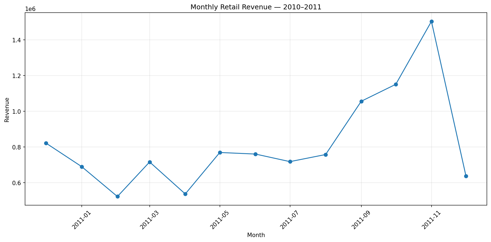

# UK Retail Sales & Customer Analytics

## Project Overview

This project analyses the UCI Online Retail dataset to identify sales trends, top-performing products, important markets, and customer purchasing patterns. The goal is to turn raw retail transaction data into actionable business insights using Python, SQL, and data visualisation.

## Business Objectives

- Measure overall sales performance.
- Identify monthly revenue trends and seasonal patterns.
- Find the products generating the most revenue.
- Compare sales performance across countries.
- Identify high-value customers.
- Demonstrate data cleaning, SQL analysis, and visualisation skills.

## Dataset

**Source:** [UCI Machine Learning Repository — Online Retail](https://archive.ics.uci.edu/dataset/352/online+retail)

The dataset contains transactions from a UK-based online retailer between 1 December 2010 and 9 December 2011.

The original dataset contains **541,909 rows** and eight columns, including invoice number, product description, quantity, invoice date, unit price, customer ID, and country.

## Tools & Technologies

- **Python:** data cleaning and analysis
- **Pandas:** data manipulation
- **Matplotlib:** data visualisation
- **SQL:** sales analysis and aggregation
- **SQLite:** querying the cleaned dataset
- **Google Colab:** browser-based development environment
- **GitHub:** version control and project documentation

## Data Cleaning

The following steps were applied before analysis:

1. Converted invoice dates into datetime format.
2. Removed duplicate rows.
3. Removed records missing essential transaction fields.
4. Excluded records with non-positive quantities or unit prices.
5. Excluded cancelled invoices identified by invoice numbers beginning with `C`.
6. Created a `Revenue` column by multiplying quantity by unit price.

After cleaning, the dataset contained **524,878 rows**, with 17,031 rows removed.

Customer IDs were retained when missing values were present, allowing sales analysis to include transactions that could not be attributed to a specific customer.

## Key Findings

### Overall Performance

| Metric | Result |
|---|---:|
| Total revenue | £10,642,110.80 |
| Cleaned transaction rows | 524,878 |
| Unique invoices | 19,960 |
| Unique identified customers | 4,338 |

*Revenue represents the sum of quantity multiplied by unit price after the cleaning steps above. It is not an audited accounting or profit figure.*

### Monthly Sales Trends

- **November 2011** recorded the highest revenue among the reported months, at approximately **£1.50 million**.
- October 2011 generated approximately **£1.15 million**.
- September 2011 generated approximately **£1.06 million**.
- February 2011 had the lowest revenue among the complete months, at approximately **£522,546**.

**Business implication:** The increase in sales towards the final quarter suggests that the retailer should investigate seasonal demand and prepare inventory and fulfilment capacity for busier periods.

*December 2011 is incomplete because the dataset ends on 9 December, so its revenue should not be compared directly with full-month totals.*

### Monthly Revenue Visualisation



### Top Products by Revenue

The leading revenue-generating entries included:

| Product | Revenue |
|---|---:|
| DOTCOM POSTAGE | £206,248.77 |
| REGENCY CAKESTAND 3 TIER | £174,156.54 |
| PAPER CRAFT, LITTLE BIRDIE | £168,469.60 |
| WHITE HANGING HEART T-LIGHT HOLDER | £106,236.72 |
| PARTY BUNTING | £99,445.23 |

**Business implication:** Product-level performance can help guide stock planning and merchandising. Postage and other non-standard entries should be separated from physical products before making inventory decisions.

### Country Performance

The United Kingdom generated approximately **£9.00 million** in revenue, making it the largest market in the dataset. The next highest-revenue countries included the Netherlands, Ireland (listed as EIRE in the dataset), Germany, and France.

**Business implication:** The UK is the core market in this dataset. International markets may offer opportunities for targeted marketing and further growth analysis.

## SQL Analysis

The SQL file contains queries to analyse:

- Overall sales metrics
- Top products by revenue
- Monthly revenue trends
- Top countries by revenue
- Top customers by revenue

The queries use SQLite syntax and expect a cleaned table named `retail_sales`.

## Repository Structure

```text
uk-retail-sales-customer-analytics/
├── README.md
├── sql/
│   └── retail_analysis.sql
└── reports/
    └── README.md
```

## Limitations

- The dataset covers a historical period from 2010 to 2011 and does not represent current retail behaviour.
- Missing customer IDs mean that some transactions cannot be linked to individual customers.
- Revenue does not account for operating costs, product costs, or profit.
- Postage and other non-standard product entries may affect product rankings.
- December 2011 covers only part of the month.

## Future Improvements

- Develop customer segmentation using RFM (Recency, Frequency, Monetary) analysis.
- Build an interactive sales dashboard.
- Investigate seasonal patterns and customer retention.
- Separate physical products from postage and other service entries.
- Explore customer purchasing behaviour and repeat-purchase rates.

## Author

MSc Data Science graduate | Interested in Data Analytics, Business Intelligence, and Data Science.
